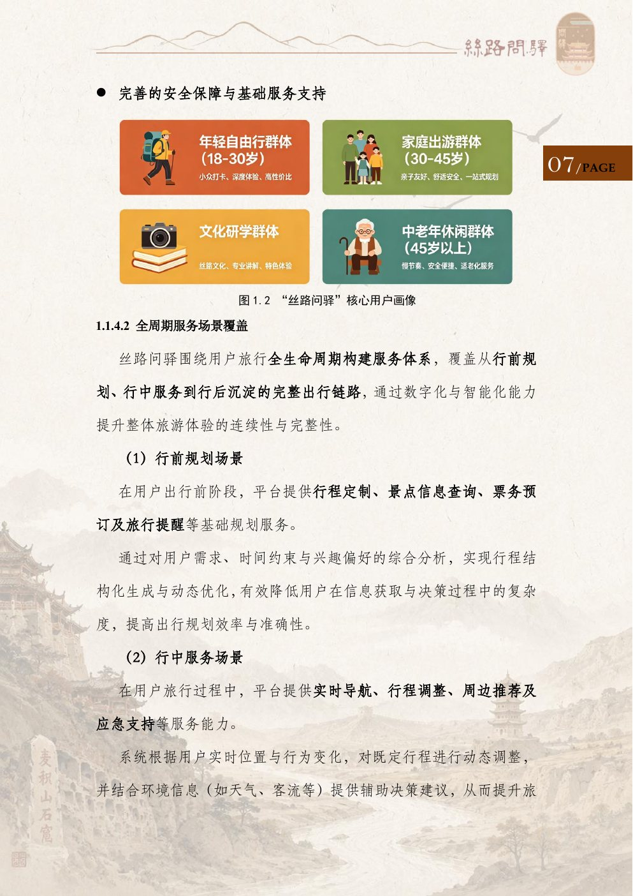
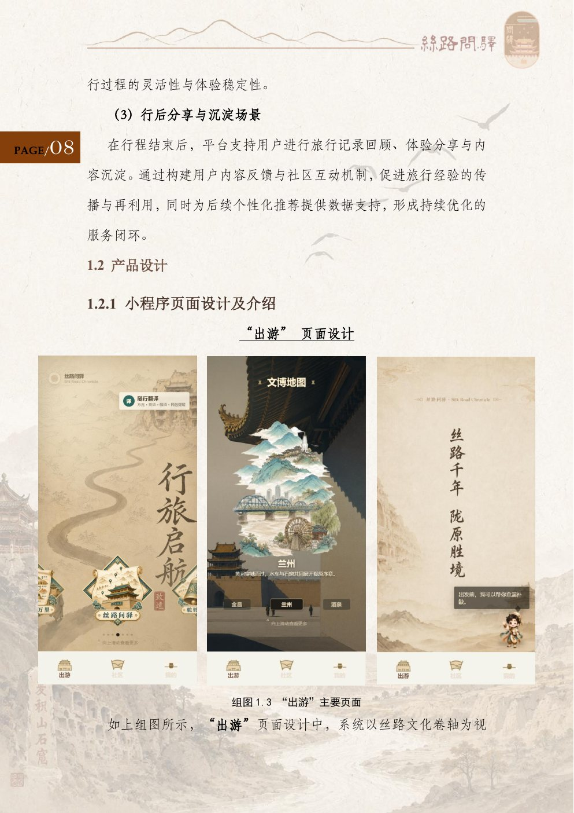
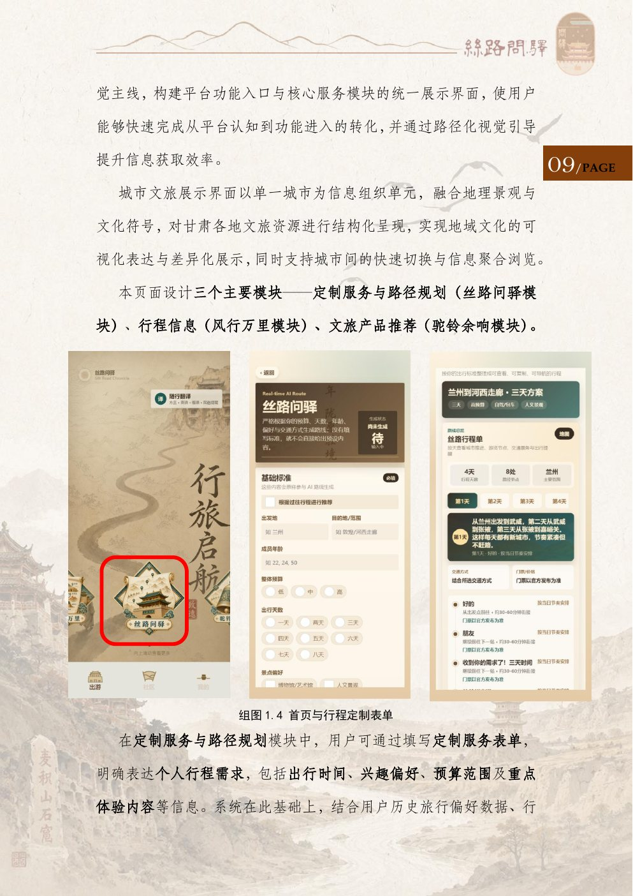
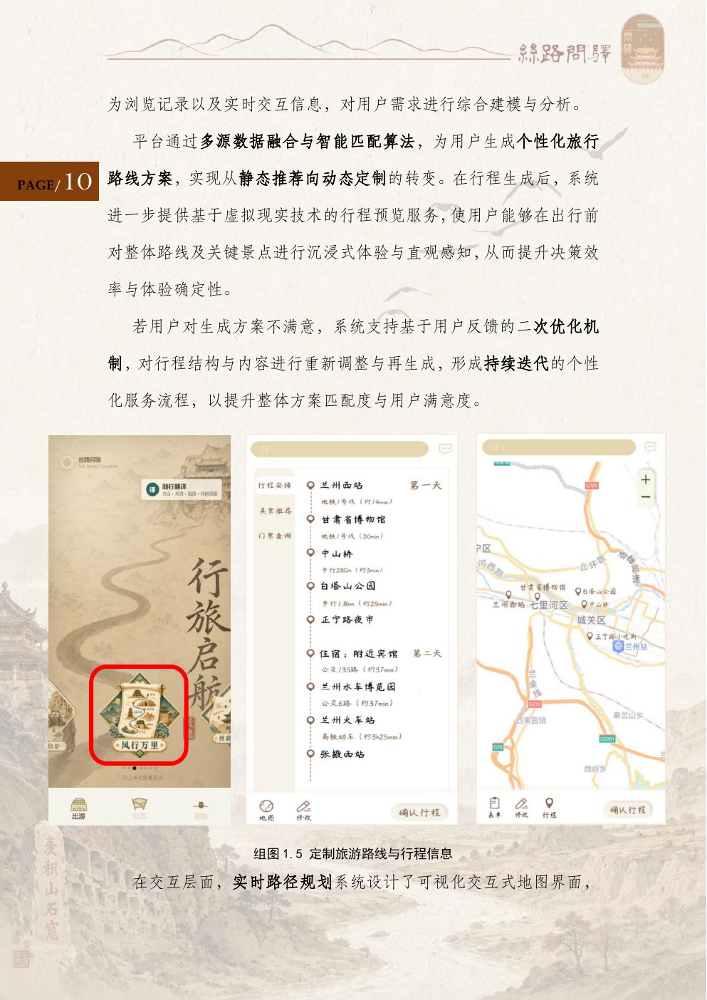
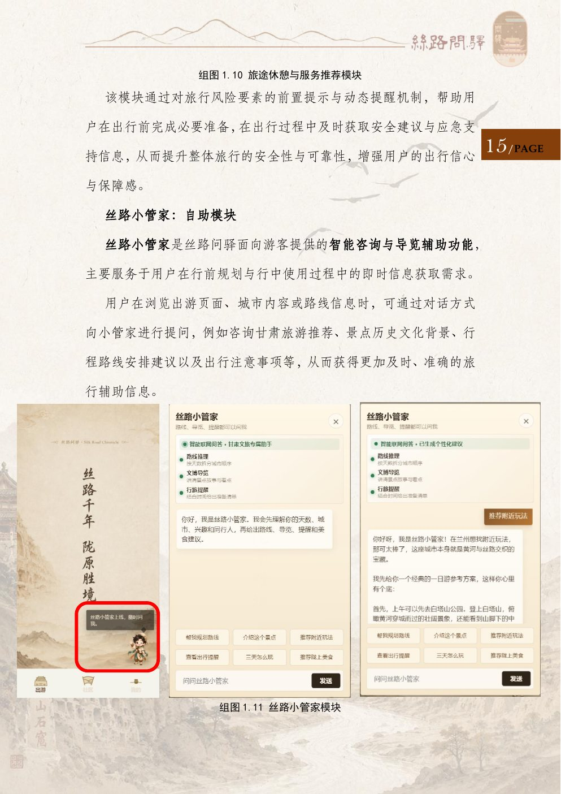
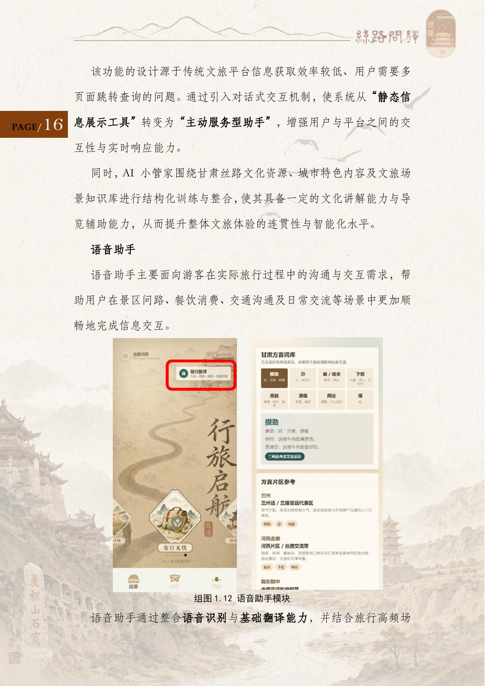
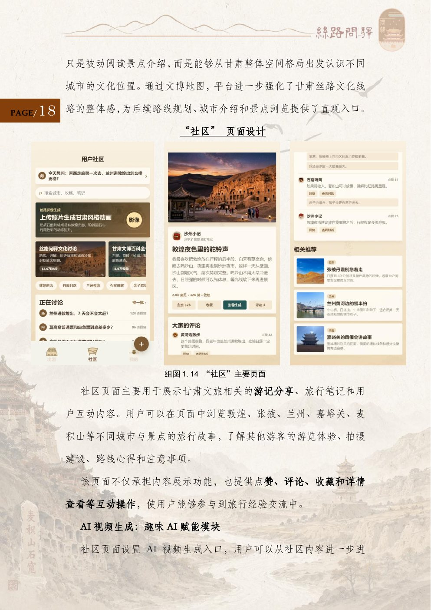
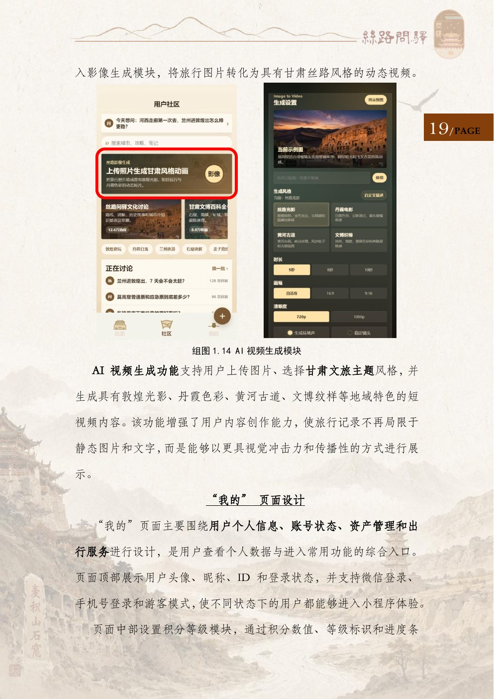
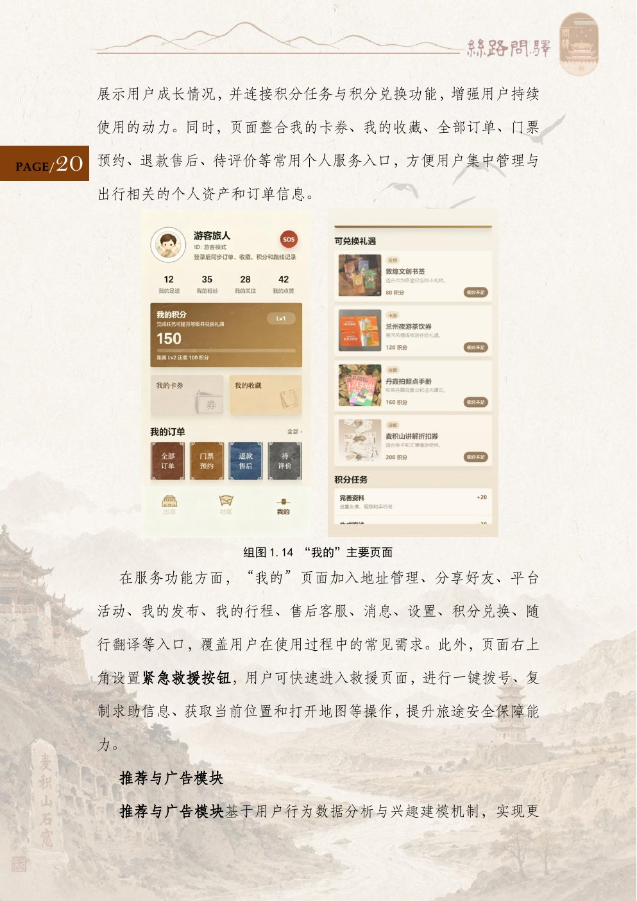

# 丝路问驿

您的个性化甘肃导游。

丝路问驿是一款以 AI 驱动的甘肃文旅平台。它不把旅行做成一条写死的线路，而是按时间、预算和兴趣，为每一位入甘游客生成可调整的行程，并一路陪到景点、方言、休憩和回家之后的回忆。

  

每一段旅程都该有自己的形状。系统读取偏好、天数和预算，生成专属方案；不满意就再改一次，路线、景点和讲解一起跟着变。旅行不再只是抵达，而是一次把丝路文明、民俗和沿途风物看清楚的过程。

## 为谁准备

平台覆盖四类入甘旅客：想深度打卡的年轻人，要省心和安全的家庭，来看石窟与丝路的文化研学者，以及需要节奏放慢、服务跟上的中老年旅客。

行前定制，行中导航与应急，行后把见闻留在社区。一条旅程在这里是完整的。

  

## 出游

首页以丝路卷轴展开。随行翻译、文博地图和城市长卷放在同一条视线上，兰州、敦煌、张掖、嘉峪关这些城市可以顺着画面走进去。

三条主线从这里分出：

- **丝路问驿**，按个人标准定制路线
- **风行万里**，把已经生成的行程收成档案
- **驼铃余响**，把旅途延伸到纹样、器物和纪念

  

## 一行行程，从一张表开始

出发地、天数、预算、同行人和兴趣点进去，系统给出一份能执行的丝路方案。行程单按天展开城市、交通和节点，也可以在地图上增删景点、调整顺序。

  

  

## 路上还有人陪着

**丝路小管家**负责行前和行中的即时问答：路线怎么拆、这座城有什么可看、今天该注意什么。它按甘肃的城市和丝路场景来答，而不是丢回一堆搜索结果。

**随行翻译**把兰州话、河西片区和丝路交流里的高频说法收在手边。问路、点菜、听懂一句方言，不必先退出行程。

  

  

## 把看见的留下来

社区收集敦煌、张掖、兰州、嘉峪关、麦积山的游记、拍摄建议和注意事项，可以赞、评、藏。上传一张照片，还能生成带有敦煌光影、丹霞、黄河古道和壁画纹样的丝路短片。

个人页记下积分、订单、卡券和收藏，紧急救援放在随手能到的位置。

  

  

  

## 项目

丝路问驿由兰州大学团队「西北小动物守望者」完成。小程序源码在本仓库中，使用微信开发者工具导入本目录即可预览。
